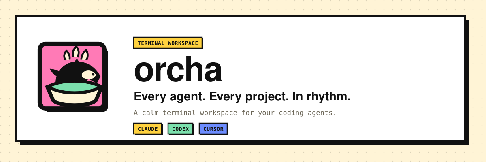
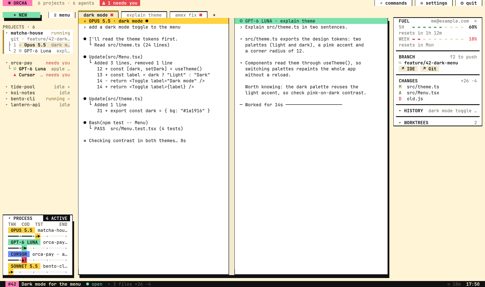
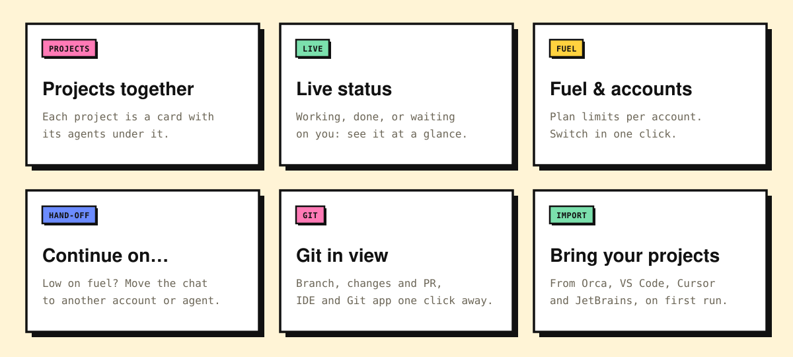
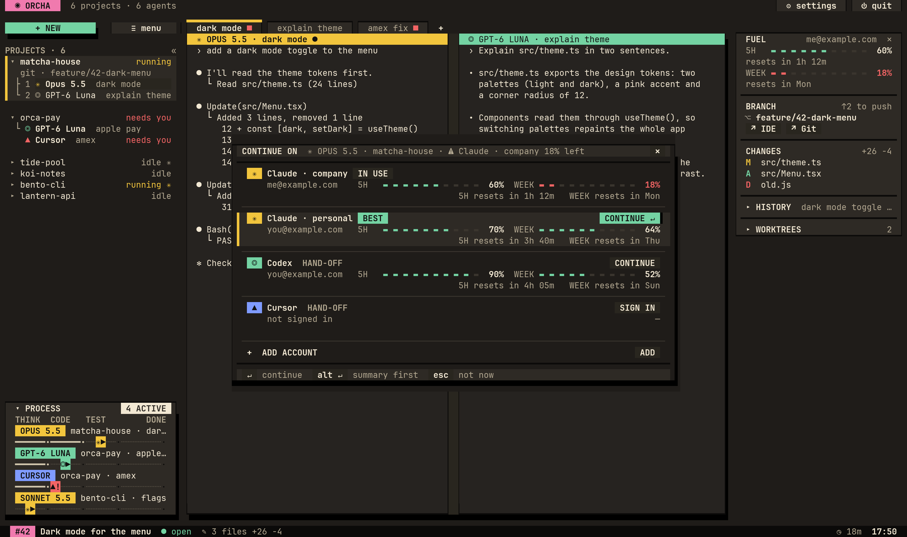
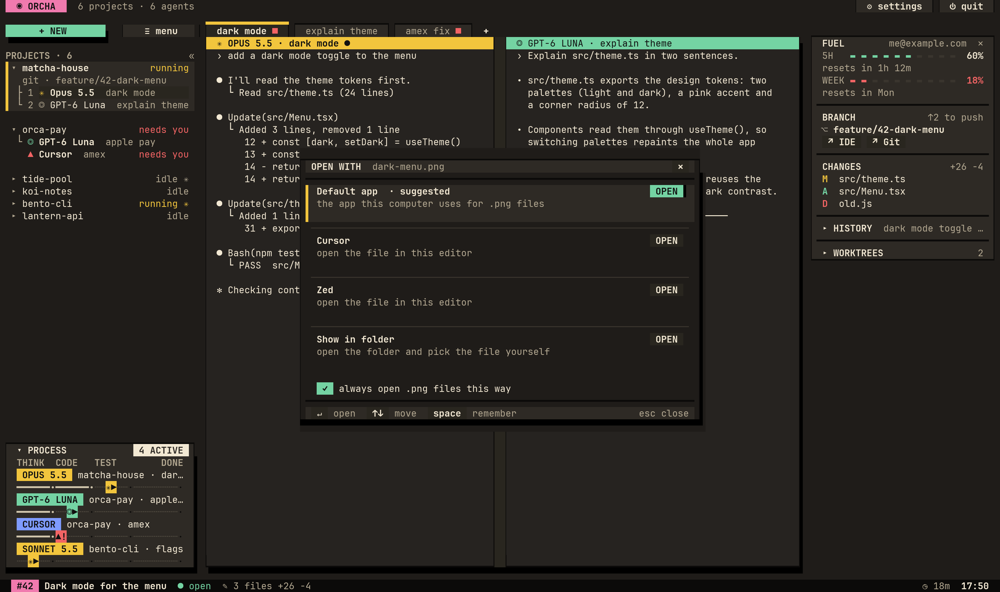
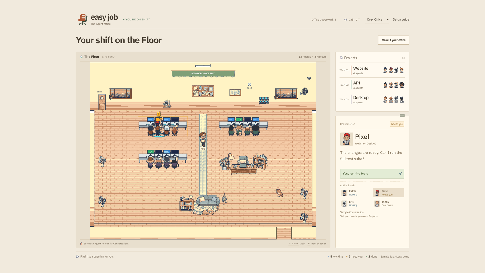

<p align="center">
  <picture>
    <source media="(prefers-color-scheme: dark)" srcset="docs/orcha/images/banner-dark.svg" />
    
  </picture>
</p>

<p align="center">
  <a href="#install"><b>Install</b></a> ·
  <a href="https://trungkien1208.github.io/orcha/">Website</a> ·
  <a href="#why-orcha-and-not-orca-or-herdr">Why orcha</a> ·
  <a href="#easy-job-a-pixel-art-office-for-your-agents">Easy Job</a> ·
  <a href="#commands">Commands</a> ·
  <a href="https://github.com/trungkien1208/orcha/issues">Feedback</a>
</p>

<p align="center">
  <picture>
    <source media="(prefers-color-scheme: dark)" srcset="docs/orcha/images/dark.png" />
    
  </picture>
</p>

<p align="center"><b>All your agents. One terminal. Zero tab chaos.</b><br/>Run Claude Code, Codex and Cursor side by side and see at a glance who's working and who needs you.<br/>The best ideas from Orca, brought to the terminal.</p>

<p align="center"><a href="https://github.com/trungkien1208/orcha/releases/latest"><b>What's new</b></a> · now with <a href="#easy-job-a-pixel-art-office-for-your-agents">Easy Job</a>, a pixel-art office for your agents</p>

## Install

**macOS** (Apple Silicon or Intel). Paste this into Terminal:

```sh
curl -fsSL https://raw.githubusercontent.com/trungkien1208/orcha/HEAD/install.sh | sh
```

**Windows** (x64). Paste this into PowerShell:

```powershell
irm https://raw.githubusercontent.com/trungkien1208/orcha/HEAD/install.ps1 | iex
```

<details>
<summary>Using cmd instead of PowerShell?</summary>

```cmd
powershell -NoProfile -ExecutionPolicy Bypass -Command "irm https://raw.githubusercontent.com/trungkien1208/orcha/HEAD/install.ps1 | iex"
```

</details>

## Get started

1. Open your terminal in a project folder.
2. Type `orcha` and press Enter.
3. That's it. orcha finds the agents you're already signed in to, and the first time it offers to bring in your projects from Orca, VS Code, Cursor or JetBrains.

The installer asks one question: do you want Easy Job, the pixel office (see below)? The answer is no unless you type `y`.

Any terminal works. For the nicest look, use [Ghostty](https://ghostty.org) on macOS or [WezTerm](https://wezfurlong.org/wezterm/) on Windows.

## What you get

<p align="center">
  <picture>
    <source media="(prefers-color-scheme: dark)" srcset="docs/orcha/images/features-dark.svg" />
    
  </picture>
</p>

- **Everything in one place.** Your projects and their agents sit in one sidebar. Each agent shows `running`, `needs you` or `done`, so nobody waits in silence.
- **Never run out mid-task.** The fuel gauge shows how much of each account's plan is left. When it gets low, **CONTINUE ON** moves the chat to another account or another agent, with a short summary so it can pick up where it left off.
- **Close it, they keep going.** Quit orcha and your agents keep working. Type `orcha` again to come back. (A restart of your computer does stop them.)
- **Click to open.** Ctrl+click a file or folder an agent mentions and it opens in your editor or file manager.
- **Git at a glance.** See your branch and changed files on the side, and open them in your editor or Git app with one click.
- **Find any action.** Click `⌕ commands` at the top and type what you want: new agent, new branch, ask every agent, open in editor.
- **Make it yours.** Light and dark themes, colors, layout and an emoji for each project. Open Settings, then `look`.

<table>
  <tr>
    <td width="50%"></td>
    <td width="50%"></td>
  </tr>
  <tr>
    <td align="center"><sub><b>CONTINUE ON</b> · switch account or agent when one runs low</sub></td>
    <td align="center"><sub><b>OPEN WITH</b> · pick which app opens each file type</sub></td>
  </tr>
</table>

## Why orcha, and not Orca or herdr?

All three run several coding agents at once. They just sit in different places:

| | Orca | herdr | orcha |
|---|---|---|---|
| **What it is** | A desktop app | A terminal engine for agents | herdr with a cockpit already built on top |
| **Where it runs** | Its own window | Your terminal | Your terminal, or over SSH |
| **Best for** | People who like windows and buttons | People who like to script and shape their own setup | People who want it all set up the first time they type `orcha` |

**Coming from Orca?** You keep the ideas you like: projects in a sidebar, every agent's status at a glance, a branch per task. You lose the 500 MB app: orcha is one 24 MB file that uses about 40 MB of memory, lives in the terminal you already use (Ghostty, WezTerm, iTerm2, tmux, your editor) and works over `ssh`. It even brings your Orca projects over on day one, so you can try both.

**Coming from herdr?** orcha *is* herdr underneath, so nothing you rely on goes away, and your settings and workspaces come along (herdr itself stays as it is). On top you get what you would otherwise build yourself:

- a ready-made look with projects, live agent status and git on the side
- fuel gauges for each account's plan, and **CONTINUE ON** to move a chat to another account or agent before one runs dry
- one search for every action (`⌕ commands`)
- a one-line install and `orcha update` on macOS and Windows
- Easy Job, a whole pixel office for your agents, one `y` away

In short: herdr is the engine, Orca is the inspiration, orcha is the two put together in your terminal.

### How heavy is it?

Measured on a Mac, sitting idle with nothing to do:

| | Memory | CPU | Download |
|---|---|---|---|
| **orcha** 0.11 | **about 40 MB** | **under 1%** | **25 MB** |
| herdr 0.9.5 | about 30 to 50 MB | under 1% | 22 MB |
| Orca 1.4 | 300 to 400 MB | about 6% | 517 MB |

So orcha uses roughly a tenth of Orca's memory, and about the same as plain herdr. Your agents get the rest.

<details>
<summary>How we measured, and the busy numbers</summary>

macOS on Apple Silicon, November 2026. For orcha and herdr we count the background server plus the window you look at, in a 200 × 56 terminal, with 1, 5 and 15 panes. For Orca we count all of its processes, with no agent running yet. Each number is a 10-second sample, and macOS compresses memory, so expect about ±10 MB between runs.

With every pane printing 30 lines a second, like busy agents:

| Panes | orcha memory | orcha CPU | herdr memory | herdr CPU |
|---|---|---|---|---|
| 1 | 43 MB | 13% | 44 MB | 12% |
| 5 | 46 to 52 MB | 18 to 26% | 46 to 49 MB | 14 to 18% |
| 15 | 49 MB | 21% | 50 MB | 19% |

orcha draws more on screen than plain herdr (projects, PROCESS, the side panel), so it uses a few points more CPU while agents print. Making that smaller is on the list.

</details>

## Easy Job: a pixel-art office for your agents

<p align="center">
  
</p>

Easy Job turns what orcha is running into a little office. Each project gets a bench, each agent gets a desk, and you walk the floor as the boss. **[Try the sample office in your browser](https://trungkien1208.github.io/orcha-plugin-office/)**, no install needed. Its code lives at [trungkien1208/orcha-plugin-office](https://github.com/trungkien1208/orcha-plugin-office).

- **See everyone at a glance.** A blue screen means working, a raised hand means it needs you, a green screen means done.
- **Answer from the floor.** Click an agent to read its chat, tap one of the answers it offers, or give it the next task. Press `n` to jump to the next raised hand.
- **Everything from orcha, in one page.** Change an agent's model, switch its account or hand the chat to a new agent.
- **Stays on your machine.** No account, no telemetry, no internet while it runs. When an agent finishes for good, two HR bouncers carry it out. Exit interviews are short.

Add it any time (the installer and orcha also offer it once, and only add it if you say yes):

```sh
orcha office install   # add Easy Job
orcha office           # open it
```

New Easy Job versions come out on their own schedule: orcha tells you when one is ready, and one click updates it. No need to wait for a new orcha.

## Commands

```sh
orcha             # open orcha (or come back to it)
orcha update      # get the latest version, and update your plugins too
orcha uninstall   # remove orcha (asks before touching your settings)
```

**Quitting orcha only closes the window.** Your agents keep working in the background, and `orcha` brings you back. After an update, switch the background part to the new version without stopping anyone:

```sh
orcha server live-handoff --import-exe ~/.local/bin/orcha   # then open orcha again
orcha server stop                                          # stops everything, agents too
```

**Easy Job, the pixel office:**

```sh
orcha office          # open it (starts it if it is off)
orcha office install  # add it
orcha office update   # get the newest one; a running office restarts on it
orcha office remove   # remove it (asks first, keeps ~/.easy-job unless you say so)
orcha plugin action invoke stop --plugin easy-job   # close it, keep it installed
```

In orcha itself, the header shows `● office` while Easy Job runs and `○ office` when it is off: click it to open. COMMANDS (`⌕ commands`) has Open, Stop, Update and Uninstall for Easy Job and every other plugin.

**Plugins in general:**

```sh
orcha plugin list                       # what is installed, and any update waiting
orcha plugin install owner/repo         # add a plugin from GitHub
orcha plugin update <id>                # get its newest version
orcha plugin uninstall <id>             # remove it
```

orcha checks once a day whether a plugin has a new version, tells you once, and keeps an Update in COMMANDS. Rather not be asked? Settings, look, "plugin updates": automatic.

orcha also shows a green button when an update of orcha itself is ready.

## Good to know

- Agent logos show up in Ghostty, WezTerm and iTerm2. Other terminals show simple symbols instead.
- Something looks wrong? [Open an issue](https://github.com/trungkien1208/orcha/issues) with your OS, terminal, orcha version and a screenshot. Beta feedback shapes 1.0.

<details>
<summary><b>Updating from an older version</b></summary>

Run `orcha update`, then switch the background part to the new version (quitting orcha alone keeps the old one running):

```sh
orcha server live-handoff --import-exe ~/.local/bin/orcha
```

Then open orcha again. Your running agents move over without stopping. If you see `config.toml has unknown keys` or a new feature is missing, this step was skipped. Avoid `orcha server stop` while agents are busy, because that stops them too.

</details>

<details>
<summary><b>For tinkerers</b></summary>

- Your own color palette: add a style file at `~/.config/orcha/styles/<name>.toml` (macOS).
- Font, size and ligature settings apply in Ghostty only.
- The macOS installer uses Python 3 for a few extras, such as hooks and the icon font.

</details>

<details>
<summary><b>Build from source</b></summary>

You need Rust and [Zig 0.16](https://ziglang.org/download/).

```sh
git clone https://github.com/trungkien1208/orcha && cd orcha
ZIG=/path/to/zig cargo build --release
cp target/release/herdr ~/.local/bin/orcha   # the name "orcha" turns on the orcha app
```

</details>

## Thanks

orcha is built on [herdr](https://github.com/herdrdev/herdr), which does the heavy lifting: running the terminals, keeping sessions alive and spotting which agent is which. orcha adds the look and the agent workflow on top, with plenty of ideas borrowed from Orca. herdr's own README is in [docs/orcha/herdr-README.md](docs/orcha/herdr-README.md).

Licensed under the [Apache License 2.0](LICENSE), like herdr.
