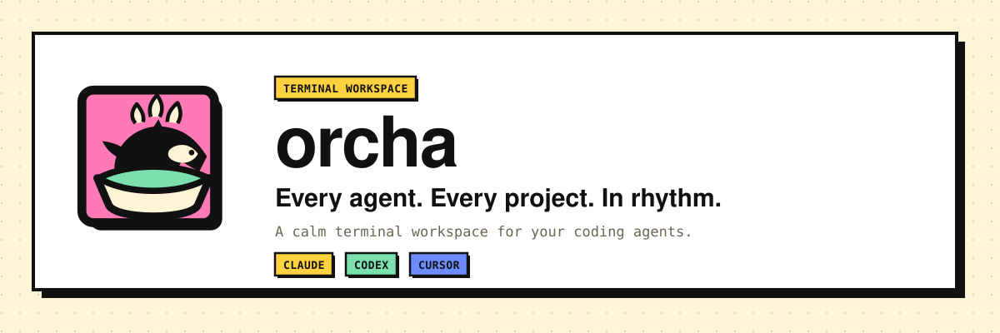
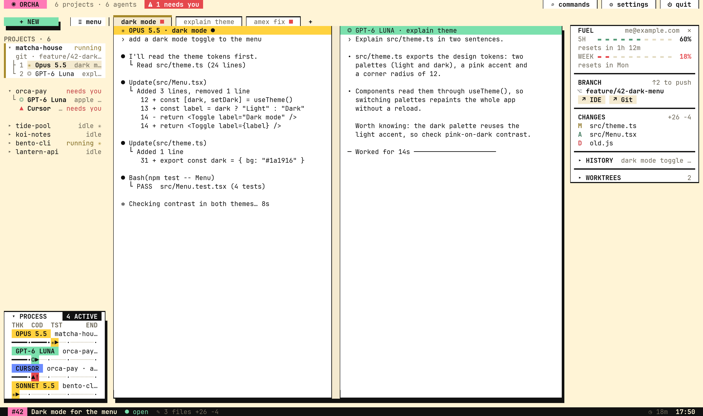
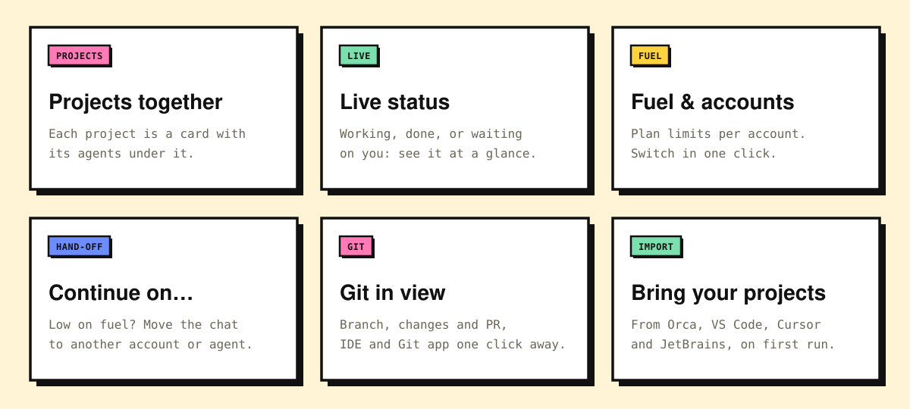
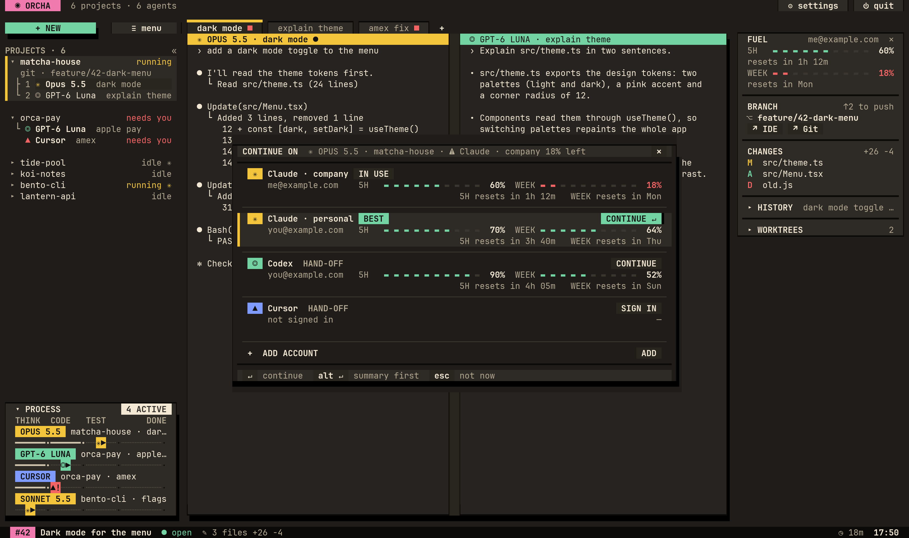
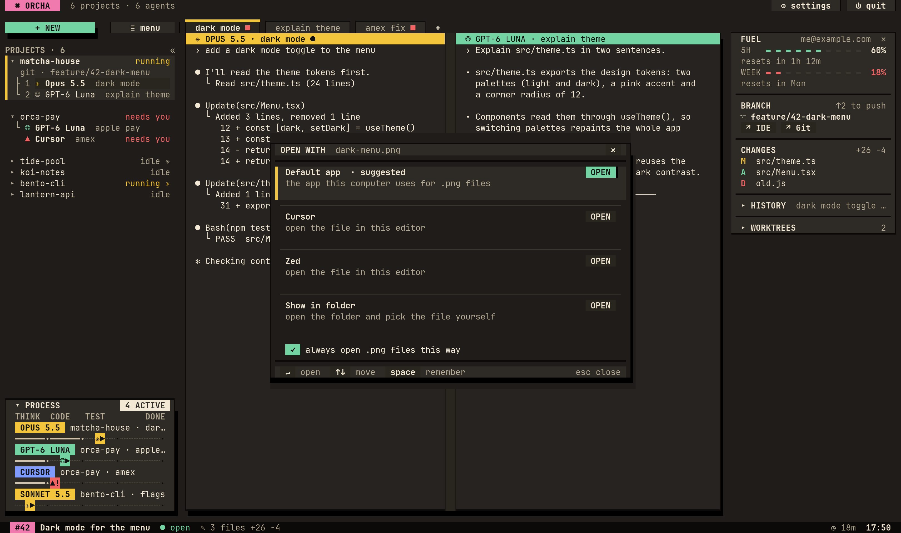

<p align="center">
  <picture>
    <source media="(prefers-color-scheme: dark)" srcset="docs/orcha/images/banner-dark.svg" />
    
  </picture>
</p>

<p align="center">
  <a href="#install"><b>Install</b></a> ·
  <a href="https://trungkien1208.github.io/orcha/">Website</a> ·
  <a href="#why-orcha">Why orcha</a> ·
  <a href="#commands">Commands</a> ·
  <a href="https://github.com/trungkien1208/orcha/issues">Feedback</a>
</p>

<p align="center">
  <picture>
    <source media="(prefers-color-scheme: dark)" srcset="docs/orcha/images/dark.png" />
    
  </picture>
</p>

<p align="center"><b>A little home for your very busy agents.</b><br/>Claude Code, Codex and Cursor, together in one terminal.<br/>See who's working and who needs a hand. Spend less time playing hide-and-seek with tabs.</p>

<p align="center"><a href="https://github.com/trungkien1208/orcha/releases/tag/orcha-0.9.9"><b>0.9.9 beta · what's new</b></a><br/>A little more room to make yourself at home: new settings, project icons and a command search.</p>

## Install

**macOS** (Apple Silicon or Intel)

```sh
curl -fsSL https://raw.githubusercontent.com/trungkien1208/orcha/HEAD/install.sh | sh
```

**Windows** (x64, PowerShell). Use [WezTerm](https://wezfurlong.org/wezterm/).

```powershell
irm https://raw.githubusercontent.com/trungkien1208/orcha/HEAD/install.ps1 | iex
```

<details>
<summary>From cmd instead</summary>

```cmd
powershell -NoProfile -ExecutionPolicy Bypass -Command "irm https://raw.githubusercontent.com/trungkien1208/orcha/HEAD/install.ps1 | iex"
```

</details>

Then run `orcha` inside a project. Your agent sign-ins are picked up automatically, and the first run offers to import projects from Orca, VS Code, Cursor and JetBrains.

Ghostty is optional. Use your usual terminal; orcha includes its own terminal engine. Fuel, accounts and hand-off run inside the app on macOS and Windows. The macOS installer still uses Python 3 for extras such as hooks and the icon font.

## Why orcha

<p align="center">
  <picture>
    <source media="(prefers-color-scheme: dark)" srcset="docs/orcha/images/features-dark.svg" />
    
  </picture>
</p>

- **Every agent at a glance.** Each project lists its tabs and agents; a folded project still shows `running` or `needs you` with the agents involved.
- **Low fuel? Pick the next driver.** Check usage per account, then choose **CONTINUE ON** to switch accounts or hand the work to another agent. A hand-off carries notes with the goal, recent conversation and changed files; you choose when to send it.
- **Paths you can click.** Ctrl+click anything an agent prints: folders open in Finder/Explorer, files in the app you pick once per type, at the right line.
- **Git beside the work.** Branch, changes and history in the side panel, one click to your IDE or Git app.
- **Close the window. Let them cook.** Quit orcha and your agents keep running in the background; `orcha` brings you back. A reboot still stops running processes.
- **One search for everything.** `⌕ commands` in the header (or the prefix key, then `:`) finds any action: new agent, worktree, hand off, ask every agent, open in IDE.
- **Move the furniture around.** Settings → `look`: put projects on either side, move or hide PROCESS, choose where FUEL sits, and tune colors and sidebar width. The layout sketch shows what goes where. Right-click a project to give it an emoji of its own.
- Start a fresh worktree from **NEW** when an agent needs its own branch and folder. Or use **Ask every agent here** to send one prompt to the agents in the current project.
- Accounts getting crowded? Open accounts, press `r` to refresh fuel or `d` to remove an entry from orcha. Removing it keeps its sign-in and chat history.

Light and dark themes are included. For your own palette, add a style to `~/.config/orcha/styles/<name>.toml` on macOS.

<table>
  <tr>
    <td width="50%"></td>
    <td width="50%"></td>
  </tr>
  <tr>
    <td align="center"><sub><b>CONTINUE ON</b> · the chat moves on when an account runs low</sub></td>
    <td align="center"><sub><b>OPEN WITH</b> · choose an app per file type, once</sub></td>
  </tr>
</table>

## Commands

```sh
orcha             # open (or come back to) your workspace
orcha update      # latest version; a green button also tells you when one is out
orcha uninstall   # remove orcha and what it added; asks before touching your settings
```

### Coming from an older version?

Run `orcha update`, then quit the interface and open it again. 0.9.9 is a public beta available through the regular installer and updater.

On macOS, if you see `config.toml has unknown keys` after upgrading, the background server may still be running the old version. Move it to the newly installed binary with:

```sh
orcha server live-handoff --import-exe ~/.local/bin/orcha
```

After it succeeds, reopen the interface. Live handoff transfers running panes to the new server. Avoid `orcha server stop` while agents are busy: that stops them too.

Best in [Ghostty](https://ghostty.org) on macOS and [WezTerm](https://wezfurlong.org/wezterm/) on Windows; any terminal works. Agent logos come from the icon font in Ghostty, WezTerm and iTerm2 when it is installed, plain symbols elsewhere (Settings → `look` → agent logos changes that). Font, size and ligature settings apply in Ghostty only; elsewhere the font is whatever your terminal uses. Using herdr already? Your config and workspaces come along, and herdr stays untouched.

Something looking wonky? [Send a bug report](https://github.com/trungkien1208/orcha/issues) with your OS, terminal, orcha version and a screenshot. Your beta feedback helps shape 1.0.

<details>
<summary><b>Build from source</b></summary>

You need Rust and [Zig 0.16](https://ziglang.org/download/).

```sh
git clone https://github.com/trungkien1208/orcha && cd orcha
ZIG=/path/to/zig cargo build --release
cp target/release/herdr ~/.local/bin/orcha   # the name "orcha" turns on the orcha app
```

</details>

## Thanks

orcha is a fork of [herdr](https://github.com/herdrdev/herdr). herdr does the hard part: the terminal runtime, sessions and agent detection. orcha adds the look and the agent workflow on top. herdr's own README is in [docs/orcha/herdr-README.md](docs/orcha/herdr-README.md).

Licensed under the [Apache License 2.0](LICENSE), like herdr.
